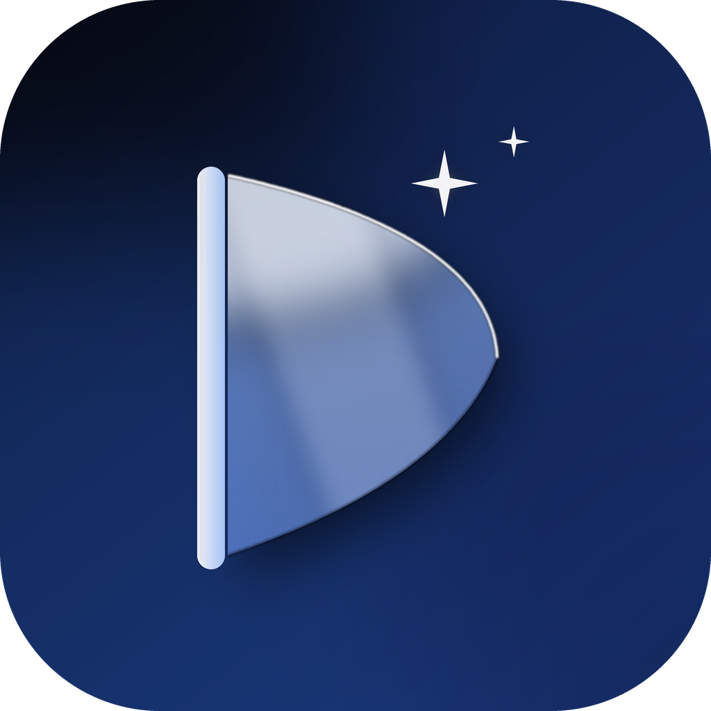
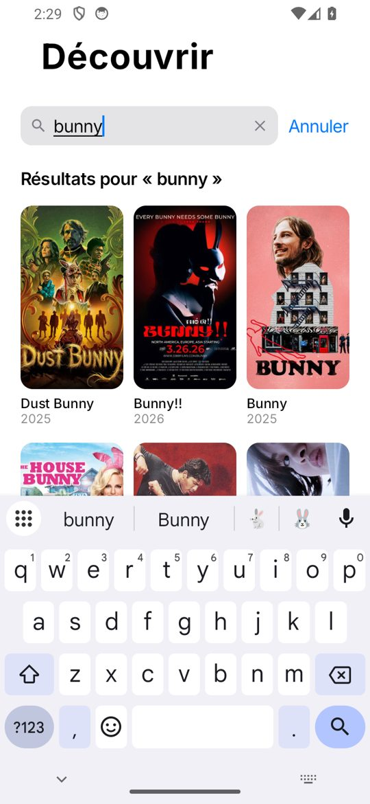
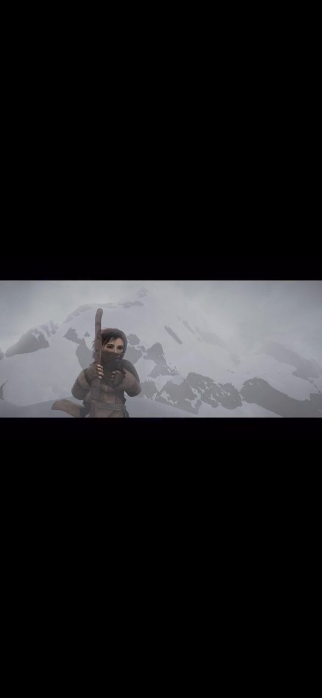
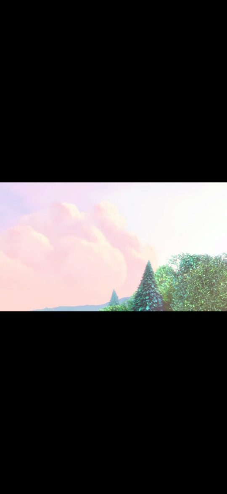
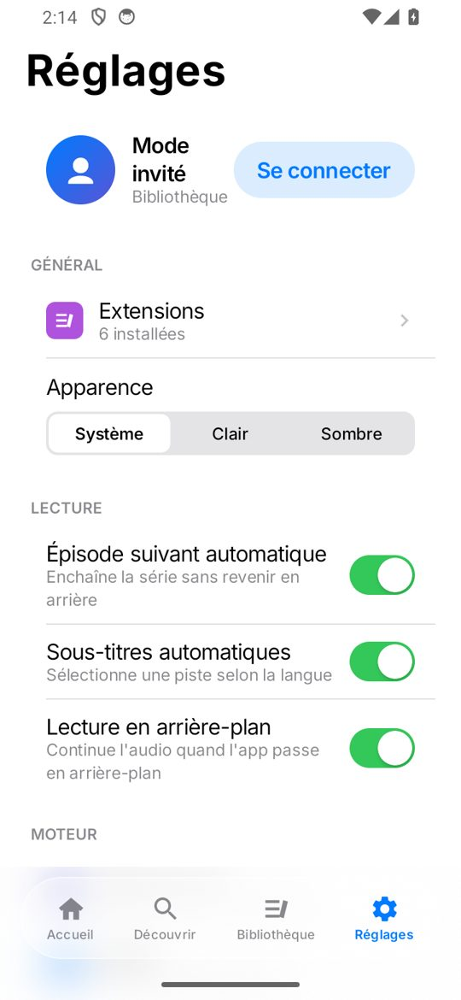

<p align="center">
  
</p>

<h1 align="center">Vela</h1>

<p align="center">
  <b>Stremio, réinventé en natif sur Android.</b><br />
  Moteur <code>stremio-core</code> réel (Rust), interface Jetpack Compose Material You, lecture HTTP, HLS et BitTorrent.
</p>

<p align="center">
  
  
  
  
  
</p>


---

## Télécharger

| | |
|---|---|
| **APK release (signé)** | [vela-1.0.7-release.apk](https://github.com/montecotsacha-hash/vela-releases/releases/download/v1.0.7/vela-1.0.7-release.apk) |
| **Taille** | 59 457 471 octets (≈ 56,7 Mio) |
| **SHA-256** | `c7ee537cd56b3bddeaece79553abac97fd357637eb6abc1aac920eb36480f6b6` |
| **Architectures** | `arm64-v8a`, `x86_64` |
| **Android** | 8.0 Oreo (API 26) → 15 (API 35) |
| **Version** | 1.0.7 (versionCode 8 · `com.vela.stream`) |
| **Signature** | certificat de release `CN=Vela` |

Vérifier le fichier téléchargé :

```bash
sha256sum vela-1.0.7-release.apk
# c7ee537cd56b3bddeaece79553abac97fd357637eb6abc1aac920eb36480f6b6
```

Installation :

```bash
adb install -r vela-1.0.7-release.apk
```

Les sommes de contrôle de tous les APK publiés sont regroupées avec la release :
[SHA256SUMS.txt](https://github.com/montecotsacha-hash/vela-releases/releases/download/v1.0.7/SHA256SUMS.txt).

---

## Nouveautés 1.0.7

- **Nouveau logo** — le V blanc et son étincelle sur tuile noire remplacent l'ancienne marque : icône adaptative, icône thématique, logo d'accueil et bannière.
- **Mises à jour intégrées** — Réglages → Général → « Rechercher les mises à jour ». L'app interroge la dernière release GitHub, compare les versions, télécharge l'APK signé et ouvre l'installeur Android (une confirmation système reste obligatoire). Si l'installation directe n'est pas possible, la page de la release s'ouvre.
- **Films à la une hebdomadaires** — les trois titres du hero sont choisis dans un pool mélangé avec la semaine ISO : ils tournent chaque lundi, restent stables pendant la semaine et se rafraîchissent même si l'app reste ouverte.
- **Correctif du tremblement des rangées** — les affiches réservent deux lignes de titre et une ligne de métadonnées. La hauteur d'une rangée ne change plus pendant un défilement horizontal rapide, donc les sections suivantes ne tremblent plus.
- **Plus d'animations bouncy** — affiches, pilules, boutons, boutons d'icône, interrupteurs, points du hero et lignes de flux ont un appui élastique ou une apparition décalée. La barre de navigation s'efface pendant l'ouverture d'une feuille.

## Nouveautés 1.0.6

- **Mot de passe visible** — un bouton œil dans le champ de connexion affiche ou masque le mot de passe sans quitter la feuille.
- **Apparition des contenus** — les affiches de films, séries et reprises entrent en fondu, glissement et légère mise à l'échelle, avec un décalage de 28 ms entre les cartes. Appliqué à l'Accueil, à Découvrir et à la Bibliothèque, et rejoué à chaque nouveau filtre.
- **Transition fiche ↔ accueil repensée** — la fiche arrive du bas en grandissant tandis que l'accueil recule et s'estompe ; au retour, la fiche s'efface vers le bas et l'accueil revient. La barre de navigation descend et remonte avec la transition au lieu de disparaître sèchement. Les changements d'onglets gagnent en rapidité et en ressort.
- **Menu « Lecture » bouncy** — la feuille des flux apparaît avec une échelle et un glissement à ressort (léger rebond), au lieu d'un simple glissement.
- **Icône plein écran agrandie** — le bouton d'agrandissement du lecteur passe à 38 dp avec une icône de 24 dp, alignée sur les autres contrôles.
- **Connexion Google** — l'API Stremio ne propose pas Google (seuls e-mail/mot de passe, Facebook et Apple sont pris en charge) ; aucun faux bouton n'a été ajouté.

## Nouveautés 1.0.5

- **Material You complet** — surfaces tonales douces, coins très arrondis, hiérarchie typographique et contraste adaptatif sur tous les écrans. Les composants translucides et le flou du dock laissent place à des surfaces Material 3.
- **Six palettes persistantes** — Sauge (par défaut), Lavande, Ambre, Océan, Corail, plus « Matériel » qui reprend la couleur dominante du fond d'écran (Android 12+). Chaque palette fournit ses rôles clairs et sombres : arrière-plans, cartes, conteneurs actifs, bordures et accents changent instantanément et sont conservés au redémarrage.
- **Nouvelle barre de navigation** — quatre onglets dans l'ordre Accueil / découvrir / bibliothèque / réglages. Capsule primaire qui glisse avec un ressort, icônes ligne à l'état inactif et pleines à l'état actif, libellé sous chaque icône, micro-animations de pression et de sélection.
- **Transitions d'onglets façon iOS 27** — glissement directionnel, fondu et mise à l'échelle synchronisés, interruption gestuelle naturelle ; repli en fondu simple quand les animations sont désactivées (accessibilité ou échelle d'animation à zéro).
- **Toggle « Liquid Glass / Flou » supprimé** — le réglage d'apparence ne garde que Clair / Sombre et les palettes.
- **Bibliothèque** — l'état vide et ses deux actions ne se superposent plus.

## Nouveautés 1.0.4

- **Nouveau logo** — le V en verre liquide holographique remplace l'ancienne tuile : icône adaptative sur toutes les densités, écran d'accueil et bannière du dépôt.
- **Bascule Flou / Liquid Glass** — dans Réglages → Apparence. Le style « Liquid Glass » ajoute les dégradés spéculaires, le liseré lumineux et un halo coloré derrière l'interface ; « Flou » garde le verre dépoli historique. Le choix s'applique à toute l'app et est conservé.
- **Nouvelle barre de navigation** — dock flottant à deux niveaux comme la référence : panneau de verre, pastille de section au-dessus, pilule intérieure, indicateur circulaire sur l'onglet actif, flou réel du contenu derrière.
- **Lecteur façon iOS 26** — carte vidéo arrondie, croix et volume en capsules de verre, boutons −10 / lecture / +10 en cercles, timeline capsule avec temps écoulé et restant, rangée de puces vitesses / sous-titres / audio / rotation / PiP.
- **Extensions : tous les catalogues** — Découvrir propose désormais les types réellement installés (Films, Séries, TV, Chaînes, Animés, Sport, Événements, Autres) au lieu de Films/Séries uniquement. Les 83 catalogues TV d'All IPTV, FayaTV, Rakuten TV ou TvVoo sont accessibles, et les chaînes se lisent en direct.
- **Sous-titres d'extensions** — le lecteur interroge les extensions `subtitles` installées (OpenSubtitles v3, SubDL, SubSource, SubSense, GlobalSubs…) en parallèle avec un délai borné, fusionne les pistes avec celles du flux et les propose dans le menu CC (Français/Anglais vérifiés sur Sintel).
- **Correctifs d'interaction du lecteur** — le détecteur de tap plein écran mangeait tous les appuis : lecture/pause, volume, CC et fermeture ne répondaient pas. La zone de tap est passée sous les contrôles, et les rangées du haut et du bas ont été remontées hors des zones système (statut / gestes).
- **Libellés** — une chaîne TV n'est plus étiquetée « FILM » sur sa fiche (TV, Chaîne, Animé, Sport, Événement, Autre).

### Compatibilité magasin d'extensions

Les 51 extensions listées sur `stremio-addons.net` ont été récupérées et leurs manifestes testés. 46 répondent et sont installables ; 5 sont injoignables côté serveur (`aiolists`, `lat-add`, `minha-tv`, `usa-tv`, `streamvix`) et non à cause de l'app. Installations et lectures réelles vérifiées dans Vela : **Torrentio** (flux 4K HDR, seeders), **All IPTV** (catalogues TV et lecture live), **Vela Demo** (MP4/HLS/torrent), plus les extensions intégrées Cinemeta, OpenSubtitles, WatchHub et Public Domain Movies.

## Nouveautés 1.0.3

- **Accueil** — les rangées de catalogues ne disparaissent plus définitivement après une recherche : le moteur partage le modèle du board, elles se rechargent au retour sur l'accueil.
- **Navigation** — Retour depuis Découvrir, Bibliothèque ou Réglages revient à l'accueil au lieu de quitter l'app ; Retour ferme aussi les feuilles (flux, options, sous-titres).
- **Fiche** — une seule action « Marquer comme vu / non vu » (les deux s'affichaient), « Reprendre » pour un film commencé, et plus de flux hérités de l'épisode précédent.
- **Lecteur** — le curseur de progression ne revient plus en arrière pendant le glissement ; la position affichée suit le doigt.
- **Fin de flux** — la progression locale est effacée : rouvrir un titre terminé repart à 0:00 au lieu de « Terminé ».
- **Sous-titres** — réellement désactivés par défaut, comme l'indiquait l'interface, avec sélection explicite de la piste choisie.
- **Recherche** — plus de roue de chargement infinie sous « Aucun résultat ».
- **Extensions** — plus de « Préparation des extensions… » sans fin quand la liste est vide.
- **Torrent** — les premières pièces du fichier choisi sont priorisées (et non celles du torrent depuis l'index 0) ; le statut n'est plus affiché en double.
- **Parcours revalidés** : MP4 (lecture, glissement 0:19 → 0:44, relecture à 0:00), HLS (1:11 / 10:34), torrent (jusqu'à 71 pairs, 100 %, 2:30 / 10:34).

## Nouveautés 1.0.2

- **Nouveau logo** — deux voiles formant un V autour du mât, en verre liquide : silhouette lisible dès 48 px, déclinée sur toutes les densités et affichée sur l'écran d'accueil de l'app (l'ancien carré « V » générique est remplacé par la vraie marque).
- **Correctif de reprise en fin de flux** — rouvrir un contenu dont la progression était à moins de 15 s de la fin affichait directement « Terminé ». La lecture repart maintenant du début et la progression est remise à zéro.
- **Parcours revalidés sur ce build** : MP4 direct, HLS adaptatif et BitTorrent (5 pairs, 100 %) lus sans erreur.

## Nouveautés 1.0.1

- **Nouvelle icône Liquid Glass minimaliste** — une voile et un mât, sans artifice, déclinée sur toutes les densités (et vérifiée sur le lanceur).
- **Barre de navigation en verre dépoli** — flou confiné à la pilule, liseré spéculaire, sélection animée et onglets répartis équitablement.
- **Magasin d'extensions** — bouton direct vers le catalogue communautaire `stremio-addons.net`.
- **Correctif d'ajout d'extension** — valider une URL restait bloqué sur « Vérification… » : le moteur normalise l'URL et l'erreur s'affichait pendant le chargement. L'aperçu s'affiche maintenant, la touche « Go » du clavier lance la vérification et un délai de 20 s évite tout blocage silencieux.
- **Affichage** — feuille d'ajout repositionnée au-dessus du clavier, contenu défilable, descriptions tronquées avec ellipsis.

## Aperçu

<table>
  <tr>
    <td align="center"><br /><sub>Accueil</sub></td>
    <td align="center"><br /><sub>Découvrir</sub></td>
    <td align="center"><br /><sub>Recherche</sub></td>
    <td align="center"><br /><sub>Bibliothèque</sub></td>
  </tr>
  <tr>
    <td align="center"><br /><sub>Lecteur</sub></td>
    <td align="center"><br /><sub>HLS adaptatif</sub></td>
    <td align="center"><br /><sub>BitTorrent</sub></td>
    <td align="center"><br /><sub>Réglages</sub></td>
  </tr>
</table>

---

## Fonctionnalités

- **Vrai moteur Stremio** — `stremio-core` compilé en Rust, piloté par JNI : catalogue, addons, bibliothèque, reprise de lecture et état du lecteur passent par le même modèle que l'app officielle.
- **Addons** — installation par URL depuis l'interface, avec aperçu du manifeste avant validation, et flux fournis par les addons installés.
- **Trois types de sources** — MP4 direct, HLS adaptatif (Media3) et torrents (magnet / infoHash).
- **BitTorrent intégré** — `libtorrent4j` télécharge en séquentiel autour du fichier lu, un petit serveur HTTP local expose le fichier à ExoPlayer avec support des requêtes `Range` (recherche, reprise, seek).
- **Lecteur complet** — vitesse de lecture, sous-titres, pistes audio, ±10 s, Picture-in-Picture, rotation, reprise à la position enregistrée.
- **Bibliothèque et reprise** — progression locale, « Continuer à regarder », ajout à la bibliothèque.
- **Mode invité** — l'app démarre sans compte ; la connexion Stremio est optionnelle.
- **UI Material You** — Jetpack Compose, typographie Inter, palettes claires et sombres, surfaces tonales, animations douces.
- **Mises à jour intégrées** — vérification de la dernière release GitHub depuis les Réglages, téléchargement de l'APK signé et ouverture de l'installeur Android.

---

## Architecture

```
app/                     Application Android (Kotlin, Jetpack Compose, Media3)
 ├── core/                CoreBridge : unique point d'entrée JNI vers le moteur Rust
 ├── player/              TorrentStreamServer (NanoHTTPD + libtorrent4j)
 └── ui/                  Écrans Compose (accueil, détail, flux, lecteur, réglages)
engine/
 ├── bridge/              Crate Rust : JNI, Env (storage, fetch HTTP, runtime tokio)
 └── vendor/              stremio-core vendorisé
```

Le pont JNI est volontairement minimal : Kotlin envoie des actions JSON et lit l'état exposé par le cœur, exactement comme le bridge web officiel. Toute la logique produit (catalogues, addons, bibliothèque, progression Stremio) reste dans `stremio-core`.

**Torrent** : le fichier choisi est priorisé en séquentiel, puis servi sur `127.0.0.1` par un serveur HTTP avec `Accept-Ranges`, `Content-Range` et réponses `206` — indispensable pour qu'ExoPlayer puisse démarrer avant la fin du téléchargement et se déplacer dans la timeline.

---

## Compiler

Prérequis : JDK 17, Android SDK (API 35), NDK 27.2.12479018, Rust avec les cibles Android.

```bash
# Application
gradle :app:assembleRelease

# Pont Rust (par ABI)
cd engine/bridge
cargo build --release --target aarch64-linux-android
cargo build --release --target x86_64-linux-android
cp target/aarch64-linux-android/release/libvela_bridge.so ../../app/src/main/jniLibs/arm64-v8a/
cp target/x86_64-linux-android/release/libvela_bridge.so   ../../app/src/main/jniLibs/x86_64/
```

La signature de release lit `keystore.properties` (non versionné) ; sans ce fichier, seule la variante debug est signée.

---

## État du projet et limites connues

- **Compte Stremio** : le mode invité et les addons sont validés de bout en bout. La connexion à un compte réel n'a pas pu être testée faute d'identifiants ; l'écran d'authentification existe mais n'est pas couvert par les tests.
- **`arm64-v8a`** : le binaire est compilé et empaqueté, mais tous les essais ont été faits sur un émulateur `x86_64`. Aucun test sur appareil ARM physique.
- **MKV** : les codecs non pris en charge par le matériel/Media3 (certains profils HEVC, audio DTS) peuvent ne pas être décodés ; il n'y a pas de transcodage côté serveur.
- **Torrent** : nécessite DHT ou trackers joignables ; un swarm vide laisse l'app en attente puis affiche une erreur explicite.
- **YouTube** : les sources YouTube ne sont pas lues.

---

## Avertissement

Projet personnel, non affilié à Stremio. « Stremio » est une marque de ses propriétaires. Vela ne fournit aucun contenu : il lit les sources exposées par les addons que vous installez, et il vous appartient de respecter les droits applicables dans votre pays.
