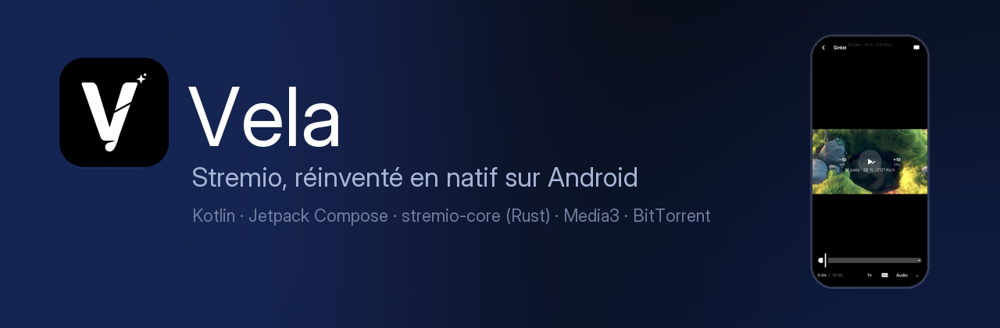
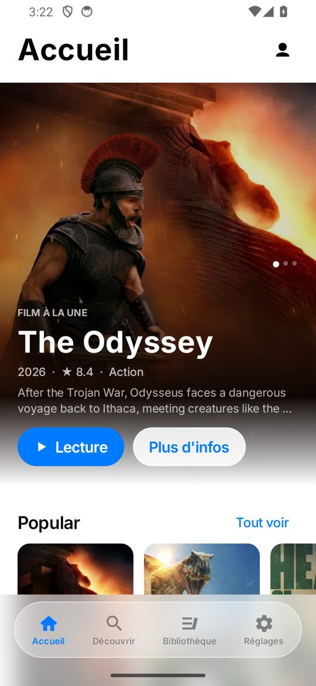
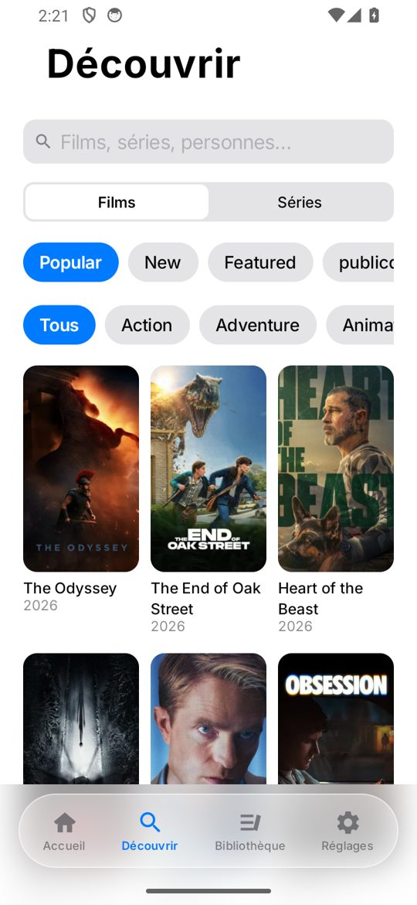
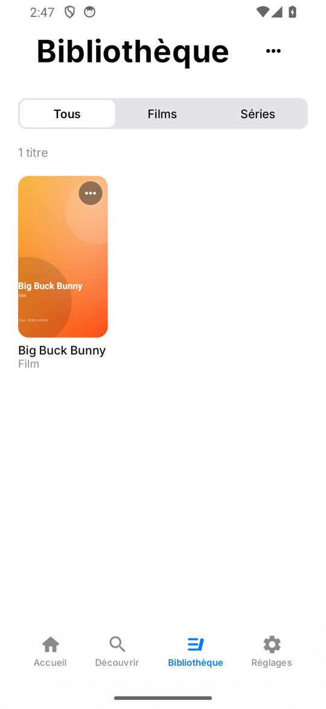
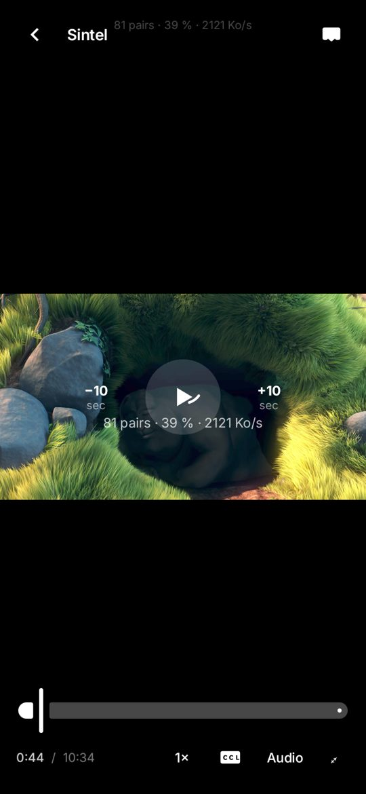

<p align="center">
  
</p>

<h1 align="center">Vela</h1>

<p align="center">
  <b>Stremio, réinventé en natif sur Android.</b><br />
  Moteur <code>stremio-core</code> réel (Rust), interface Jetpack Compose inspirée d'iOS 26, lecture HTTP, HLS et BitTorrent.
</p>

<p align="center">
  
  
  
  
  
</p>



---

## Télécharger

| | |
|---|---|
| **APK release (signé)** | [vela-1.0.0-release.apk](https://github.com/montecotsacha-hash/vela-releases/releases/download/v1.0.0/vela-1.0.0-release.apk) |
| **Taille** | 59 337 494 octets (≈ 56,6 Mio) |
| **SHA-256** | `c362b5fce4cab7115ad3a213d2da3cc1153ea684fbcca8ed377de08ae4182491` |
| **Architectures** | `arm64-v8a`, `x86_64` |
| **Android** | 8.0 Oreo (API 26) → 15 (API 35) |
| **Version** | 1.0.0 (`com.vela.stream`) |
| **Signature** | certificat de release `CN=Vela` |

Vérifier le fichier téléchargé :

```bash
sha256sum vela-1.0.0-release.apk
# c362b5fce4cab7115ad3a213d2da3cc1153ea684fbcca8ed377de08ae4182491
```

Installation :

```bash
adb install -r vela-1.0.0-release.apk
```

Les sommes de contrôle des deux APK (release et debug) sont publiées avec la release :
[SHA256SUMS.txt](https://github.com/montecotsacha-hash/vela-releases/releases/download/v1.0.0/SHA256SUMS.txt).

---

## Aperçu

<table>
  <tr>
    <td align="center"><br /><sub>Accueil</sub></td>
    <td align="center"><br /><sub>Découvrir</sub></td>
    <td align="center"><br /><sub>Recherche</sub></td>
    <td align="center"><br /><sub>Bibliothèque</sub></td>
  </tr>
  <tr>
    <td align="center"><br /><sub>Lecteur</sub></td>
    <td align="center"><br /><sub>HLS adaptatif</sub></td>
    <td align="center"><br /><sub>BitTorrent</sub></td>
    <td align="center"><br /><sub>Réglages</sub></td>
  </tr>
</table>

---

## Fonctionnalités

- **Vrai moteur Stremio** — `stremio-core` compilé en Rust, piloté par JNI : catalogue, addons, bibliothèque, reprise de lecture et état du lecteur passent par le même modèle que l'app officielle.
- **Addons** — installation par URL depuis l'interface, avec aperçu du manifeste avant validation, et flux fournis par les addons installés.
- **Trois types de sources** — MP4 direct, HLS adaptatif (Media3) et torrents (magnet / infoHash).
- **BitTorrent intégré** — `libtorrent4j` télécharge en séquentiel autour du fichier lu, un petit serveur HTTP local expose le fichier à ExoPlayer avec support des requêtes `Range` (recherche, reprise, seek).
- **Lecteur complet** — vitesse de lecture, sous-titres, pistes audio, ±10 s, Picture-in-Picture, rotation, reprise à la position enregistrée.
- **Bibliothèque et reprise** — progression locale, « Continuer à regarder », ajout à la bibliothèque.
- **Mode invité** — l'app démarre sans compte ; la connexion Stremio est optionnelle.
- **UI Liquid Glass** — Jetpack Compose, typographie Inter, matériaux translucides, thème sombre, animations douces.

---

## Architecture

```
app/                     Application Android (Kotlin, Jetpack Compose, Media3)
 ├── core/                CoreBridge : unique point d'entrée JNI vers le moteur Rust
 ├── player/              TorrentStreamServer (NanoHTTPD + libtorrent4j)
 └── ui/                  Écrans Compose (accueil, détail, flux, lecteur, réglages)
engine/
 ├── bridge/              Crate Rust : JNI, Env (storage, fetch HTTP, runtime tokio)
 └── vendor/              stremio-core vendorisé
```

Le pont JNI est volontairement minimal : Kotlin envoie des actions JSON et lit l'état exposé par le cœur, exactement comme le bridge web officiel. Toute la logique produit (catalogues, addons, bibliothèque, progression Stremio) reste dans `stremio-core`.

**Torrent** : le fichier choisi est priorisé en séquentiel, puis servi sur `127.0.0.1` par un serveur HTTP avec `Accept-Ranges`, `Content-Range` et réponses `206` — indispensable pour qu'ExoPlayer puisse démarrer avant la fin du téléchargement et se déplacer dans la timeline.

---

## Compiler

Prérequis : JDK 17, Android SDK (API 35), NDK 27.2.12479018, Rust avec les cibles Android.

```bash
# Application
gradle :app:assembleRelease

# Pont Rust (par ABI)
cd engine/bridge
cargo build --release --target aarch64-linux-android
cargo build --release --target x86_64-linux-android
cp target/aarch64-linux-android/release/libvela_bridge.so ../../app/src/main/jniLibs/arm64-v8a/
cp target/x86_64-linux-android/release/libvela_bridge.so   ../../app/src/main/jniLibs/x86_64/
```

La signature de release lit `keystore.properties` (non versionné) ; sans ce fichier, seule la variante debug est signée.

---

## État du projet et limites connues

- **Compte Stremio** : le mode invité et les addons sont validés de bout en bout. La connexion à un compte réel n'a pas pu être testée faute d'identifiants ; l'écran d'authentification existe mais n'est pas couvert par les tests.
- **`arm64-v8a`** : le binaire est compilé et empaqueté, mais tous les essais ont été faits sur un émulateur `x86_64`. Aucun test sur appareil ARM physique.
- **MKV** : les codecs non pris en charge par le matériel/Media3 (certains profils HEVC, audio DTS) peuvent ne pas être décodés ; il n'y a pas de transcodage côté serveur.
- **Torrent** : nécessite DHT ou trackers joignables ; un swarm vide laisse l'app en attente puis affiche une erreur explicite.
- **YouTube** : les sources YouTube ne sont pas lues.
- **Reprise en fin de flux** : rouvrir un contenu dont la progression est proche de la fin peut afficher l'écran « Terminé » immédiatement au lieu de repartir du début.

---

## Avertissement

Projet personnel, non affilié à Stremio. « Stremio » est une marque de ses propriétaires. Vela ne fournit aucun contenu : il lit les sources exposées par les addons que vous installez, et il vous appartient de respecter les droits applicables dans votre pays.
